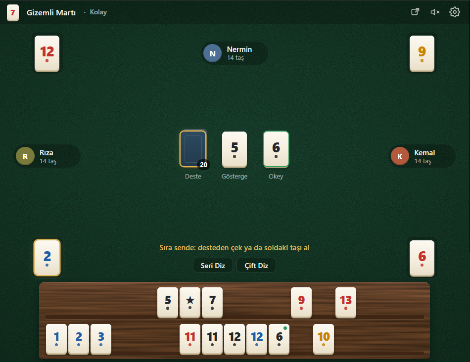

# Okey Chrome Extension

A browser-based Okey game built as a Chrome extension using JavaScript, HTML, and CSS.

<p align="center">
  
</p>

## Overview

This project brings the classic tile-based Okey game into a browser extension. The interface includes a game table, tile rack, draw pile, indicator and Okey tiles, and other players around the table.

The project is developed collaboratively by **[ens159](https://github.com/ens159)** and **[akifnar](https://github.com/akifnar)**.

## Features

- Browser-based Okey game interface
- Tile rack and table layout
- Game indicators, including the indicator tile and Okey tile
- Controls for arranging tiles, including **Seri Diz** and **Çift Diz**
- Player and turn information displayed during gameplay

> The feature list should be updated as the game evolves. Only list features that are currently available in the version on the `main` branch.

## Tech Stack

- **JavaScript** — game behavior and logic
- **HTML** — page structure
- **CSS** — layout and visual styling
- **Chrome Extensions** — browser integration

## Installation

You can load the extension locally in Google Chrome:

1. Clone this repository:

   ```bash
   git clone https://github.com/ens159/chrome-extension-okey.git
   ```

2. Open Chrome and go to `chrome://extensions`.
3. Turn on **Developer mode**.
4. Click **Load unpacked**.
5. Select the cloned project folder — the folder containing `manifest.json`.
6. Open the extension and try it out.

## Project Structure

The main files currently used by the project include:

| File | Purpose |
| --- | --- |
| `manifest.json` | Chrome extension configuration |
| `background.js` | Background functionality |
| `game.html` | Game page structure |
| `game.js` | Game interface and interactions |
| `logic.js` | Game logic |
| `style.css` | Visual styling |

## Development

This is a collaborative project. We use Git and GitHub to manage source code, track changes, and work on features.

When contributing, please keep changes focused and use clear commit messages. For larger changes, consider working on a separate branch and opening a pull request.

## Contributors

- [ens159](https://github.com/ens159)
- [akifnar](https://github.com/akifnar)

---

Made with JavaScript and a love for Okey.
